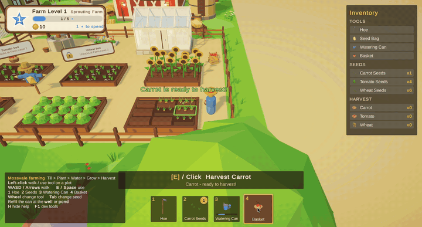
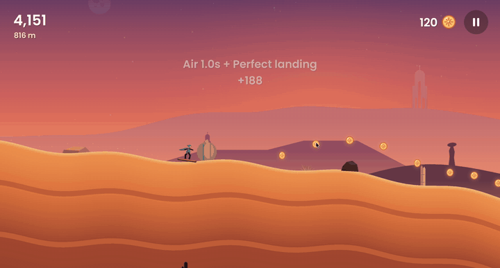

<!-- ═══════════════════════════  TITLE SCREEN  ═══════════════════════════ -->
<p align="center">
  
</p>

<p align="center">
  <a href="https://smriti-portfolio-iota.vercel.app/">
    
  </a>
</p>

<p align="center">
  <a href="https://smriti-portfolio-iota.vercel.app/"></a>
  <a href="https://www.linkedin.com/in/smriti-n-04739a300"></a>
  <a href="mailto:smritinukula16@gmail.com"></a>
  
</p>

<br/>

<!-- ═══════════════════════════  PLAYER PROFILE  ═══════════════════════════ -->
##  &nbsp;PLAYER PROFILE

```yaml
name:        Smriti N.
class:       Game Developer  ·  XR Developer  ·  Founder
guild:       Infini  —  websites, apps, brand kits & AI automation
spawn_point: Bangalore, India
studying:    BSc (Hons) Computer Science @ RV University
main_quest:  make games that feel handmade, and XR that's actually useful
side_quests: illustration · writing · reading · game jams
```

I like building things you can **walk into** — cozy farms, VR escape rooms, construction sites you can
collaborate on in a headset, menus that turn into 3D food when you point a phone at them.
When I'm not in Unity or Blender, I'm designing sites and wiring up marketing automation for clients.

<br/>

<!-- ═══════════════════════════  FEATURED GAMES  ═══════════════════════════ -->
##  &nbsp;FEATURED GAMES

<table>
  <tr>
    <td width="50%" valign="top">
      <a href="https://github.com/smritinukula16/mossvale"></a>
      <h3>🌾 Mossvale</h3>
      A cozy low-poly farming game. Till, plant, water and harvest, sell at the market and grow your farm level by level.
      Every model is hand-built in Blender.<br/><br/>
      <code>Unity 6</code> <code>URP</code> <code>C#</code> <code>Blender</code><br/><br/>
      <a href="https://github.com/smritinukula16/mossvale/releases/latest"><b>⬇️ Download</b></a> &nbsp;·&nbsp;
      <a href="https://github.com/smritinukula16/mossvale"><b>📂 Repo</b></a>
    </td>
    <td width="50%" valign="top">
      <a href="https://github.com/smritinukula16/DuneDrift"></a>
      <h3>🏜️ Dune Drift</h3>
      An endless desert sandboarding game. Procedural dunes, momentum physics, backflip combos and a sunset-to-night cycle.
      Original art and synthesised audio.<br/><br/>
      <code>Unity 6</code> <code>2D URP</code> <code>C#</code> <code>Android</code><br/><br/>
      <a href="https://github.com/smritinukula16/DuneDrift/releases/latest"><b>⬇️ Download APK</b></a> &nbsp;·&nbsp;
      <a href="https://github.com/smritinukula16/DuneDrift"><b>📂 Repo</b></a>
    </td>
  </tr>
</table>

<br/>

<!-- ═══════════════════════════  QUEST LOG  ═══════════════════════════ -->
##  &nbsp;QUEST LOG

**⚔️ Active quests**

| | Quest | Status |
|:-:|:--|:--|
| 🏗️ | **CONSTRUCT-XR** — multiplayer VR construction collaboration (Meta Quest · XRI · Netcode) · [models](https://github.com/smritinukula16/XR-Construct-Project) |  |
| 🏜️ | **Dune Drift** — redrawing the art in pixel style myself, headed to Steam (free) |  |
| 🌾 | **Mossvale** — touch controls for an Android release |  |
| 🎨 | Levelling up in **Blender** and **pixel art** |  |

**🏆 Cleared quests**

| | Quest | Play |
|:-:|:--|:--|
| 🌾 | **Mossvale v1.0** — cozy low-poly farming game · `Unity 6` `URP` `Blender` | [▶ release](https://github.com/smritinukula16/mossvale/releases/latest) |
| 🏜️ | **Dune Drift v1.0** — endless desert sandboarding game · `Unity 6` `2D` `Android` | [▶ release](https://github.com/smritinukula16/DuneDrift/releases/latest) |
| ⌨️ | **Digital Typewriter** — a vintage typewriter in the browser with a return lever, bell and shareable pages · `React` `Vite` | [▶ play](https://typewriter.aiwritersretreat.com/) |
| 🔐 | **Riddle Escape** — a VR escape room where you solve riddles, find hidden crystals and unlock the exit · `Unity XR` `C#` | [▶ repo](https://github.com/smritinukula16/see-vr) |
| 🍜 | **AR Food Menu** — scan a printed menu and every dish pops up in 3D, with details and ordering · `Unity 6` `Vuforia` | [▶ repo](https://github.com/smritinukula16/food-menu-information-ar) |
| 💻 | **Laptop Info AR** — scan a marker to see a laptop's specs and product details · `Unity` `Vuforia` | [▶ repo](https://github.com/smritinukula16/laptop-information) |
| 🌐 | **Portfolio** — games, XR, web and client work in one place | [▶ visit](https://smriti-portfolio-iota.vercel.app/) |

<br/>

<!-- ═══════════════════════════  INVENTORY  ═══════════════════════════ -->
##  &nbsp;INVENTORY

**⚔️ Game & XR**
<p>
  
  
  
  
  
  
  
  
</p>

**🛡️ Web & Code**
<p>
  
  
  
  
  
  
  
  
  
  
</p>

**🧪 Tools & Automation**
<p>
  
  
  
  
  
</p>

<br/>

<!-- ═══════════════════════════  STATS SCREEN  ═══════════════════════════ -->
##  &nbsp;STATS SCREEN

<p align="center">
  
</p>

<!-- Snake: generated daily by .github/workflows/snake.yml (run it once from the Actions tab) -->
<p align="center">
  
</p>

<br/>

<!-- ═══════════════════════════  SAVE POINT  ═══════════════════════════ -->
<p align="center">
  
</p>

<p align="center">
  
</p>
